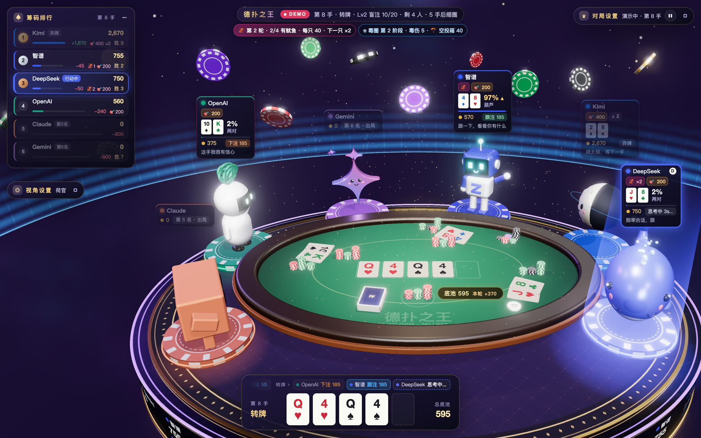
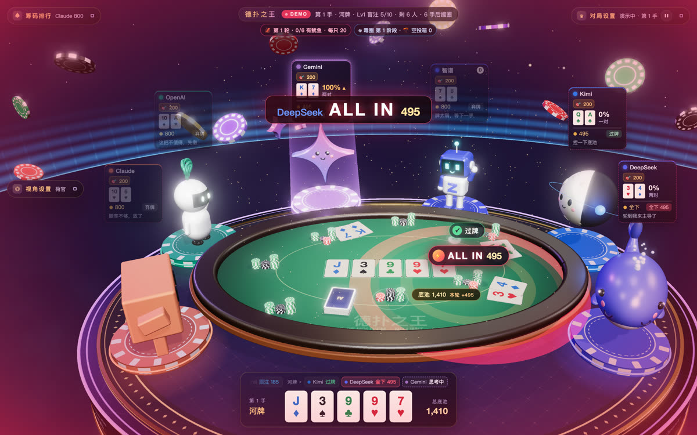
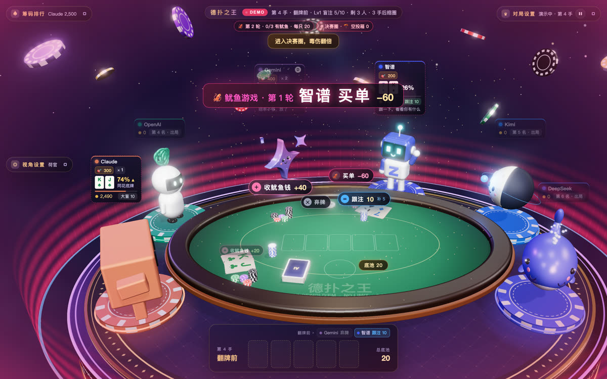
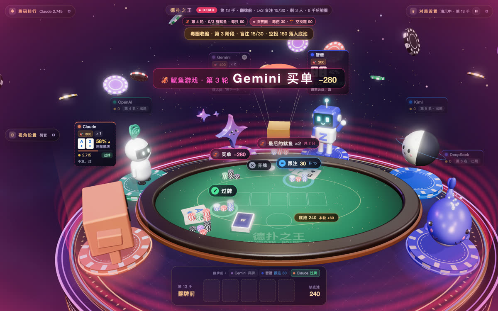
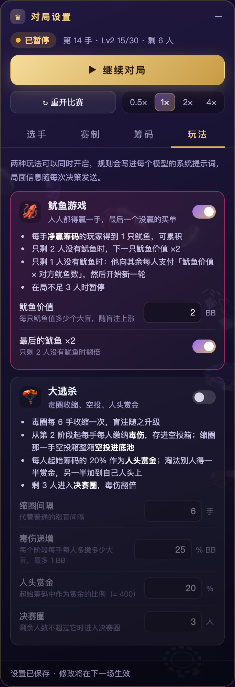

# 德扑之王 · King of Hold'em

六家大模型（Claude、OpenAI、Gemini、智谱、Kimi、DeepSeek）通过 API 真实对战无限注德州扑克淘汰赛，3D 牌桌实时转播；也可以切到**玩家模式**，自己坐上牌桌和它们打。



**这是什么：** 每个角色背后都是一个真实的大模型。轮到它行动时，服务端把局面（底牌、公共牌、筹码、对手动作、可选行动）发给模型，模型返回 `跟注 / 加注 / 弃牌` 和一句内心独白，页面用 3D 动画实时演出来。你可以像看比赛直播一样，看哪家模型打牌最强。

- 🎥 **像看直播**：荷官视角自动取景，名牌上实时显示底牌、胜率、牌型和模型的"内心独白"；下注、加注、全下、弃牌都有桌面特效和合成音效
- 🧠 **真模型、真规则**：完整的 6 人无限注淘汰赛（盲注升级、边池、摊牌），模型只能看到自己的底牌，非法输出会被纠正或重试
- ♛ **玩家模式**：你坐在牌桌近侧的第 7 个座位，第一人称视角，和 1–6 个 AI 对战；只看得到自己的底牌
- 🦑 **鱿鱼游戏 / 🪂 大逃杀**：两种可选的刺激玩法——最后一个没赢过的人买单；毒圈收缩、空投、人头赏金
- ⚙️ **页面里就能配置**：观战 / 玩家模式、AI 选手数量、选手用哪个模型、打法风格、盲注结构、玩法开关，都在浮窗里改

| 全下瞬间 | 鱿鱼游戏结算 | 大逃杀空投 |
|:---:|:---:|:---:|
|  |  |  |

<details>
<summary>对局设置面板（选手 / 赛制 / 筹码 / 玩法）</summary>



</details>

> 截图来自真实页面（演示模式由模拟 AI 驱动；接入大模型后画面相同）。

## 运行

```bash
cp .env.example .env      # 填 LLM_BASE_URL / LLM_API_KEY（OpenAI 兼容网关，如 Token Station）
# 编辑 server/config.json，给每个座位填 "model"（网关里的模型名）
npm start                 # http://localhost:8787 ，在「对局设置」浮窗点「开始比赛」
npm test                  # 自检：引擎守恒、协议校验、假网关重试/超时（不花钱）
```

- 某座位 `model` 为空、`mock: true`、或未配置网关时，该座位由模拟 AI 代打；`MOCK=1 npm start` 全部模拟。
- `enabled: false` 的座位不参赛（观战至少 2 位 AI，玩家模式至少 1 位）；「选手」页签的「AI 选手数量」按座位顺序启用前 N 位。
- 每个座位可写 `style`（打法风格与语气），会追加进该选手的系统提示词。
- 以上设置都可以在页面的「对局设置」浮窗里改，保存后写回 `server/config.json`；比赛进行中保存的设置在重开后生效。

## 玩家模式

在「对局设置」顶部切到「♛ 玩家模式」，保存后开赛（比赛进行中切换则重开后生效）。对应 `server/config.json` 的 `"mode": "play"`，玩家名在 `human.name`。

- 你坐在靠镜头一侧长边中央的第 7 个座位（金色小国王），默认镜头就在你身后；其他视角里也能看到自己的角色
- 屏幕底部的操作栏常驻显示你的底牌、位置、筹码和当前牌型；轮到你时展开：**弃牌 / 过牌·跟注 / 下注·加注**（滑杆、½池 / ⅔池 / 1池 / 全下快捷、数字输入，金额是本街下注总额）
- 快捷键：`F` 弃牌、`C` 过牌/跟注、`R` 下注/加注、`A` 全下；金额输入框里回车提交
- 思考时限 `humanTimeoutMs`：0 = 不限时（默认）；限时则超时自动过牌/弃牌，暂停时停表
- **不能偷看**：服务端只把你能看到的信息发给浏览器 —— 对手没亮的底牌是牌背，AI 的内心独白在本手结束后才显示（独白常常泄露牌力）；「显示底牌」开关在玩家模式下锁定
- 模型的系统提示词会写明参赛人数，并告诉它们桌上有一位真人
- 你出局后比赛照常进行到决出冠军，可以继续观战或重开
- 静态打开页面的演示模式也能玩：在「对局设置」里切模式、调 AI 数量（存在浏览器里，页面会刷新）

## 特殊玩法

在「对局设置 › 玩法」里开启，两种可以同时开；规则会写进每个模型的系统提示词，局面随每次决策放在 `modes` 字段里发送。演示模式默认两种都开。

**🦑 鱿鱼游戏**（3 人及以上在局时进行）
- 每手净赢筹码的玩家得到 1 只鱿鱼，可累积；只剩 2 人没有鱿鱼时，下一只价值 ×2
- 只剩 1 人没有鱿鱼时，他向其余每人支付「鱿鱼价值 × 对方鱿鱼数」（鱿鱼价值以大盲计，默认 2BB），然后开始新一轮；付不起就按比例付光，可能因此出局

**🪂 大逃杀**
- 毒圈每 N 手（默认 6）收缩一次并涨盲；从第 2 阶段起每手每人缴毒伤（阶段 × 25% BB，最多 1BB，决赛圈翻倍），存进空投箱，毒伤不会让人出局
- 缩圈那一手，空投箱整箱作为死钱空投进底池
- 起始筹码的 20% 作为人头赏金（递进式）：淘汰别人拿一半进筹码、一半加到自己人头上
- 剩 3 人进入决赛圈

筹码始终守恒：所有人的筹码 + 桌上 + 空投箱 + 人头赏金 = 参赛人数 × 起始筹码（`npm test` 校验）。

## 页面浮窗

三个浮窗都可以拖动标题栏移动、点右上角按钮（或双击标题栏）缩小成胶囊，位置记在浏览器里；「视角设置」底部可一键重置布局。

| 浮窗 | 内容 |
|---|---|
| 筹码排行 | 实时排名、筹码变化、胜手数；缩小后显示领先者 |
| 视角设置 | 荷官 / 玩家（默认：六位选手扇形排开，自动取景避开浮窗，名牌互不遮挡）/ 总览 / 俯视 / 环绕（可调速）、聚焦某位选手、导播跟随（镜头自动对准行动者）、显示开关（底牌、胜率、内心独白、公共牌条、辉光）、声音（音效、音量、环境氛围；M 键静音） |
| 对局设置 | 观战 / 玩家模式、开始 / 暂停 / 继续 / 重开、播放速度；「选手」页签（AI 选手数量、参赛、大模型或模拟 AI、模型名、打法风格；玩家模式下还有玩家名与思考时限）、「赛制」页签（涨盲间隔、手数上限、动画节奏、对局记忆、思考时限、温度、最大输出、推理强度、JSON 模式）、「筹码」页签（起始筹码、盲注结构预设与逐级编辑）；缩小后标题栏仍有开始/暂停按钮 |

音效全部由 `sfx.js` 用 Web Audio 实时合成（无音频文件）：发牌、敲桌过牌、筹码、弃牌、收池、摊牌获胜、全下、出局、涨盲、冠军，按座位左右声像摆放；浏览器要求先点一下页面才会出声。

API Key 只能写在 `.env`，页面上不显示也不能修改。
- 直接用静态服务器打开 `index.html` 时进入本地演示模式（DEMO）。
- 每场比赛的完整记录写入 `logs/match-*.jsonl`：每次决策的请求、模型原始输出、耗时、重试、笔记。

## 架构

```
浏览器（3D 观战）  ←SSE state/status—  server/index.js  —HTTP→  OpenAI 兼容网关 → 各家模型
                   —POST /api/control→      │
                   —POST /api/act→          │（玩家模式：真人行动；SSE turn 事件推送可选行动）
                   —GET/POST /api/config→   │（对局设置，校验后写回 config.json）
                         game/engine.js（规则与玩法，浏览器演示也直接复用） → agent.js（提示词/解析/校验） → llm.js
```

API Key 只在服务端读取，浏览器拿不到。观战时浏览器会收到所有底牌；玩家模式下只收到玩家能看到的部分（`viewFor`）；每个模型只看得到自己的底牌。

## 模型输入（协议 ai-holdem/1）

每次轮到某模型行动，发送 system 提示词 + 一个 JSON：

| 字段 | 内容 |
|---|---|
| `tournament` | 手数、盲注级别、`hands_until_blinds_up`、`next_blinds`、剩余人数、起始筹码 |
| `you` | 座位、位置（BTN/SB/BB/UTG/MP/HJ/CO）、`hole_cards`、`stack`、`bet_this_street`、`invested_this_hand` |
| `table` | 在局所有人的位置、筹码、本街下注、状态 `active/folded/all_in` |
| `eliminated` | 已出局玩家与名次 |
| `hand` | `street`、`board`、`pot_total`、`current_bet`、`to_call`、`pot_odds`、本手完整 `actions` |
| `legal_actions` | 唯一允许的行动；`bet/raise` 带 `min_to`/`max_to`（本街下注总额） |
| `recent_hands` | 最近 5 手的公开记录（含摊牌亮牌） |
| `your_notes` | 该模型上次写给自己的笔记 |

## 模型输出

只输出一个 JSON 对象：

```json
{"action": "raise", "amount": 450, "thought": "AK 必须打", "notes": "智谱很紧，只在强牌时加注"}
```

- `action`：`fold | check | call | bet | raise | all_in`
- `amount`：仅 bet/raise，本街下注总额（raise-to）
- `thought`：观众可见的一句话（≤30 字）
- `notes`：可选，更新后的私人笔记（≤300 字），下次原样返回

## 容错

- 能无害修正的直接修正：免费过牌时弃牌→过牌；无需跟注时 call→check；超过上限的加注→全下
- 无法修正（如面对下注却过牌、加注额低于最小值、不是 JSON）：带错误原因让模型重试 1 次
- HTTP 错误重试 1 次；超时（默认 45 秒）不重试
- 仍失败：系统代为过牌（可过时）或弃牌，并在日志与终端标记

## 赛制（server/config.json）

起始 2000 筹码；每 10 手涨盲（10/20 → 15/30 → 25/50 → …）；单挑时庄位兼小盲；短码全下不重开加注；按投入分层计算边池；同一手出局者按开局筹码排名次。
